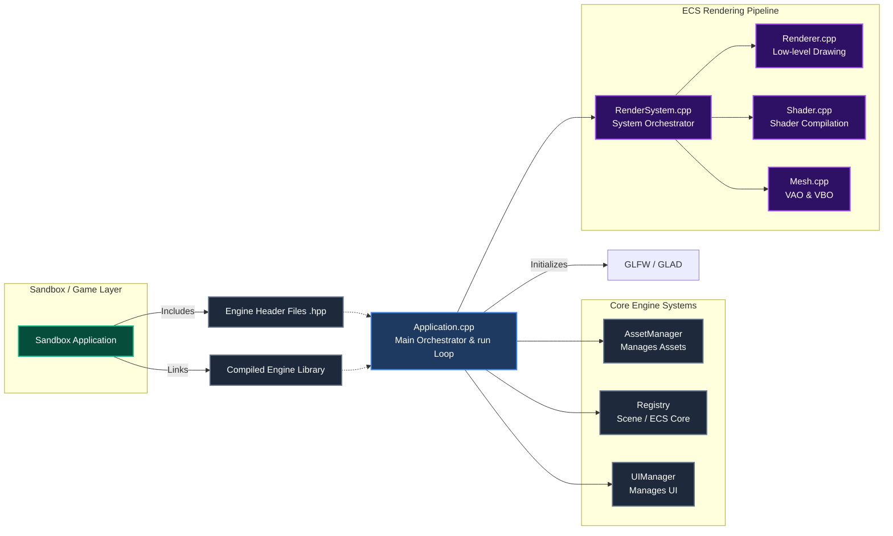

# Engine Overview

This is a very broad overview of how the engine works. It helps you naviagte the file structure, and how the engine is currently structured.

### File Structure

This explains the engine file structure. We have the high level overview from the root directory, and then a more indepth view of it.

```text
├── assets/                 # Engine Assets (textures, shaders, models, etc.)
├── external/               # External Libraries
├── engine/                 # Engine source and headers
├── sandbox/                # Testing enviornment
├── tests/                  # Unit Tests 
├── CMakeLists.txt          # Main CMake configuration file
├── LICENSE                 # MIT License
├── README.md               # Engine Overview File
└── vcpkg.json              # vcpkg Manifest Mode configuration file
```

**engine/ Directory:**

I'd say that the engine directory is well so that you can intuitively tell what each folder does, so please let me know if you think otherwise. It is divided into include/ for engine headers, and src/ for source implementation, but they both mirror the same folder structure, with some minior differences (i. e. include/core/ has a Helper.hpp file for helper functions, and src/ has stb_implemtation.cpp file for stb_image).
**The engine/ directory has a CMakeLists.txt file which is configuration file for just the engine code.**

```text
├── asset/          # Asset Manager and Asset Loaders
├── core/           # Core Engine Files
├── ecs/            # Sparse-Set ECS implementation
├── rendering/      # All rendering specific code 
├── scene/          # Manages the overall scene, using the ECS implementation
├── stats/          # Engine Statistics (updated by other systems)
└── ui/             # UI Specific Code using ImGui
```

### Engine Architecture

The following section is split into a diagram and worded explanation section. The worded explanation section comes first, followed by the diagram, made with mermaid. 

#### Worded Explanation

This is a very broad overview of the engine architecture. There will be seperate pages in which I go more in depth as to how they actually work. 
The way that the structure is explained is in large, vague-ish chunks. 

We can start at the heart of the engine [Application.cpp](../../engine/src/core/Application.cpp). This is the main orchestrator file, where we initalize things like GLFW, GLAD, etc. and set up our Registry, AssetManager, ECS systems, etc. and also contains the run() function. 

We can then branch off into the other major systems, AssetManager, Registry, and UIManager. AssetManager manages all of the assets in the engine. Registry is the centeral manager of our scene, using the ECS implementation. We will go more indepth in that in [ECS Implementation](ECS.md). And UIManager manages the creation of our UI.

For ECS systems, right now we just have [RenderSystem](../../engine/src/rendering/RenderSystem.cpp). It is the orchestrator of all the rendering parts, like [Renderer](../../engine/src/rendering/Renderer.cpp), [Shader]((../../engine/src/rendering/Shader.cpp)), [Mesh]((../../engine/src/rendering/Mesh.cpp)), etc. We will discuss the renderer further in depth in the [Renderer Page](RENDERER.md).

Circling back to the overall architecture, I would like to explain how I seperate the engine and the game. Right now, we call it sandbox. Sandbox, as stated before, is our developer testing enviornment. However, it could be represented as a game (and for the sake of this). Our engine builds the source code as its own library and the sandbox interacts with it via the engine header files. This is why we seperate the .hpp and .cpp implementation of the files. This is also how the engine will be distributed when developers distribute games in the future. 

#### Diagrams

##### Overall Engine Flow

